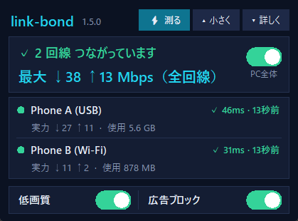
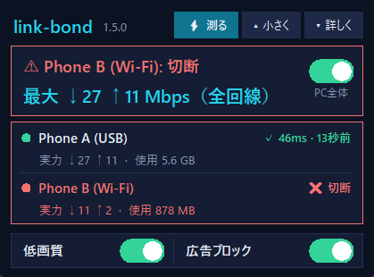

# link-bond（回線まとめ）

**Windows で、つないだ回線を全部同時に使って速くし、モバイル通信量も節約する無料の道具です。**
テザリングやプリペイド SIM で暮らす人向け: USB のスマホ、Wi-Fi の別のスマホ、ポケットルーターなど。

**⬇ [最新版をダウンロード](https://github.com/baadee55/link-bond/releases/latest)** ・ **[やさしい解説（図と手順）→ docs/GUIDE.ja.md](docs/GUIDE.ja.md)** ・ [English → README.md](README.md)

小さな浮かぶ箱（ウィジェット）1つで全部操作します。中身は小さなローカルプロキシです（Python のファイル1つ・追加インストール不要・サーバー不要・アカウント不要・無料）。

* **全回線を同時に使う** … つながっている回線を全部、それぞれの速さに比例して同時に使います。ブラウザ・並列ダウンロード・複数アップロードで、速さが足し算になります。
* **一部が切れても止まらない** … 切れた回線に残っていた通信はすぐ残りの回線へ移し、残り全部で通信を続けます。戻ればまた加わります。状態が変わるたびに「Phone B: 切断（1本で継続中）」のように知らせます。
* **ダウンロードも全回線で** … 付属の Chrome 拡張機能を入れると、Chrome のダウンロードを link-bond が受け取り、1つのファイルを全部の回線から同時に取ります。大きな1ファイルでも、回線の合計の速さになります。箱に URL を貼っても取れます。
* **低画質モード（最初から ON）** … 動画の速さを合計約 2.5 Mbps に絞り、プレイヤーが自動で画質を下げます（480p 前後）。通信量が大きく減ります。
* **プリペイドの残りが見える** … 携帯会社で確認した残りを入力すると、この PC が使った分を引き、80 / 95 / 100% で知らせます。チャージはワンクリックで加算。
* **通知** … スマホのネットが切れた（プリペイド切れらしいときはヒント付き）、Windows が別の Wi-Fi に勝手につなぎ替えた、スマホのテザリングが止まった、よく切れる、を Windows の通知で。毎日「昨日はこれだけ使いました」も。
* **広告ブロック**（任意）と、詳しい画面 <http://127.0.0.1:1081>。
* link-bond が落ちても数秒でプロキシを外すので、**ネットが止まったままになりません。**

## 小さな箱（ウィジェット）

デスクトップのアイコン1つで開きます。じゃまにならない作りです。

* **ひと目で分かる** … 「✓ 2 回線 つながっています」と「**最大 ↓◯ ↑◯ Mbps（全回線の合計）**」。回線ごとに「✓ 46ms・13秒前」（15 秒ごとの小さな確認＝生きている証拠）、実力、使用量。
* **問題の所だけ赤** … 切断・テザリング停止・VPN で束ねが止まった など。たたんだピルは、問題があれば全体が赤になって中身を出します。
* **小さく、動かせる** … タイトルバーをつかんで移動。マウスが離れると薄くなります（右クリックで透明度・常に手前）。
* 一番上の **「⚡ 測る」** … 全回線の実力を測ります（1回線 約 3MB。押した時だけ）。
* **「PC全体」スイッチ** … ON = PC 全体が link-bond を使う、OFF = 元の設定（箱と通知は動き続けます）。
* **「▾ 詳しく」** … グラフ・ダウンロード・残り容量・出来事のタブ。

  

箱を閉じても（✕）隠れるだけです。デスクトップのアイコンでまた出ます。「完全に終了」で全部止めて、元の設定に戻します。

## 先に読んでください（正直な限界）

| | |
|---|---|
| **ふつうの通信1本は、1回線の速さ** | ブラウザのタブ1つや動画1本は、1回線の速さのままです。足し算になるのは、通信が何本も同時に動くとき、または「全回線で高速ダウンロード」を使ったときです。パケットを1つずつ分ける本格的な束ね（Speedify など）は有料サーバーが必要です。link-bond はあえてサーバーを持たないので、無料で、通信が外部に出ません。 |
| **全回線を常に使う** | つながっている回線は全部、速さに比例して同時に使います（10倍遅い回線には、接続の約 1/10）。切れたら残りで全部を運び、戻ればまた加わります。他の機器と共有しているスマホのホットスポットも、そのぶん忙しくなります。 |
| **高速ダウンロードは Range 対応のサーバーが必要** | ほとんどのサーバーは対応しています。非対応なら、一番速い1回線で取ります。自分で URL を貼るファイル用で、ブラウザが自分で取る物には効きません。 |
| **本当に別の回線が必要** | 別のスマホ・別の SIM・別の契約。同じスマホの2つの接続は1本です。 |
| **携帯会社の本当の残高は PC から読めない** | 最初の残りは手で入力します。link-bond は、**この PC が**その端末で送受信した量だけを引きます。いつでも入力し直せます。 |
| **低画質モードは「画質を強制」しない** | 通信は暗号化されているので、動画サーバーの速さを絞る方式です。再生中の動画は、少し待つか再読み込みが必要なことがあります。 |
| **Windows 10 / 11 のみ**、Python 3.9 以上（tkinter 入り。公式インストーラなら入っています） | |

## つかいかた

1. [Python 3.9 以上](https://www.python.org/downloads/) を入れます（「Add python.exe to PATH」にチェック）。
2. [最新版](https://github.com/baadee55/link-bond/releases/latest) の zip をダウンロードして、好きな場所に展開します。
3. 端末をつなぎます（USB テザリング、Wi-Fi のホットスポット、有線など）。
4. **`install.bat`** をダブルクリック。デスクトップにアイコン **link-bond** が1つでき、全部が動き出します。
5. **2本以上を同時につなぐ PC では、`keep-connected.ps1` を1回実行してください**（右クリック →「PowerShell で実行」。下の「同時につなぎ続ける」）。
6. **おすすめ：Chrome の拡張機能を入れる**（ダウンロードが自動で全回線に）。`chrome://extensions` →「デベロッパー モード」ON →「パッケージ化されていない拡張機能を読み込む」→ `browser-extension` フォルダ。箱の「詳しく」→「ダウンロード」→「Chrome に入れる」でも同じ手順が出ます。

アイコンを使わずに試す: `python bond.py` を実行し、アプリのプロキシを `127.0.0.1:1080`（SOCKS5 か HTTP）にします。

## 同時につなぎ続ける（keep-connected.ps1）

Windows は、そのままだと次のように回線を勝手に切ることがあります。

* 有線（**USB テザリングは有線扱い**）がつながると、Wi-Fi を切る（「同時接続を最小にする」機能）。
* 省電力のために、USB や Wi-Fi のアダプタを止める。
* スマホのホットスポットが一瞬消えると、保存済みの別の Wi-Fi に乗り換える。

`keep-connected.ps1` を1回実行すると、これを全部止めます（管理者の許可の画面が1回出ます）。**何も再起動しないので、実行中も回線は切れません。** アダプタの設定は、次につなぎ直したときから効きます。元に戻すときは `keep-connected.ps1 -Undo`。

## 全回線で高速ダウンロード

箱の「▼ 詳しく」→ URL を貼る →「取得」。ファイルを 1MB ずつに分け、全部の回線が次々に取りに行きます。速い回線は多く、遅い回線は少なく運び、最後は手の空いた回線が遅い回線の分を取り直すので、遅い回線を待ちません。できたファイルは「ダウンロード」フォルダに入ります（同じ名前があっても上書きしません）。箱に、各回線が運んだ割合が出ます。受け付けるのは公開の `http(s)` の URL だけです。

## 3本目、4本目…を足すには

link-bond の側に上限はありません。IPv4 アドレスと既定の経路を持つアダプタは、約 10 秒で自動的に回線として加わります（設定は要りません）。限りがあるのは機械の側です。

1. **スマホをもう1台、USB ケーブルで** つなぎ、USB テザリングを ON（Android: 設定 → テザリング。iPhone: インターネット共有。PC に Apple Devices / iTunes が必要）。ポートが足りなければ給電つき USB ハブ。挿しても認識されない（デバイス マネージャーに「Device Descriptor Request Failed」）ときは、ほぼケーブルかポートの問題です。別のケーブル・背面のポートを試してください。
2. **USB の Wi-Fi 子機**（安い物で可）で、別のスマホのホットスポットにつなぐ。内蔵の Wi-Fi は同時に1つのホットスポットにしかつながりません。
3. **SIM を入れる USB モデム / ポケット Wi-Fi**。USB 接続なら、自動でネットワーク機器として出ます。
4. **有線 LAN**（家のインターネット）も1本になります。

速さが足し算になるのは、別の SIM・別の契約のときだけです。2台のスマホが同じアドレス帯で競合するときは、片方を Wi-Fi ホットスポットにしてください。多くの Android は、USB を抜くと USB テザリングが OFF に戻ります。挿し直したら ON にしてください（ON にし忘れていると、箱と通知で「テザリング停止中 → スマホで OFF→ON」と出ます）。

## ON で PC に起きること（OFF で元に戻ります）

* ユーザーごとの Windows のプロキシを `127.0.0.1:1080` にします（元の設定は `proxy-backup.json` に保存）。社内・家庭内の宛先はプロキシを通しません。
* 再起動後も戻るよう、link-bond と箱をスタートアップに登録します。
* **OFF** ですぐ元のプロキシ設定に戻ります。**完全に終了** で全部止めて、スタートアップの登録も消します。
* link-bond は `127.0.0.1` だけで待ち受けます。画面の書き込みは専用のヘッダと localhost の Host が必要なので、他のサイトの Web ページから設定を変えられません。

Windows のプロキシ設定を見ないアプリ（一部のゲーム、VPN クライアント、コマンドラインの道具）は、そもそも影響を受けません。

## 回線が切れたとき

* 切れた回線に残っていた通信はすぐ閉じて、アプリは生きている回線でつなぎ直します。つながらない回線は 4 秒であきらめて次へ行き、すぐ確認します。切断の判定は約 30 秒。
* 変化は全部、箱の「出来事」と、全回線の状態つきの Windows の通知に出ます。
* スマホが落ちたあと Windows が保存済みの別の Wi-Fi につないだときは「別のネットワーク」と知らせます（そのあいだの速さや使用量は別のネットワークの物です）。

## VPN

**PC 版の VPN と束ねは同時に使えません。2本以上を束ねるときは、PC 版の VPN を切ってください。** PC 版の VPN（NordVPN、WireGuard など）は、全通信を1本のトンネルにまとめて1つの回線で送ります。VPN がついている間、link-bond はそれに従い（通信は VPN 経由）、速度測定と切断チェックを止め、物理回線に出していた接続を閉じて、その旨を通知します。低画質モードと広告ブロックはそのまま効きます。

スプリットトンネリングでも解決しません。NordVPN から link-bond（そのための専用名 `linkbond.exe`）を外しても、外したアプリが使えるのは NordVPN の「メインの回線」1本だけです（実測: 1本は通り、他は拒否）。つまり「VPN ＋ link-bond 経由で1本」になり、束ねにはなりません。ブラウザの VPN 拡張機能は独自のプロキシを使うので、どちらの場合も影響を受けません。

## 回線の選び方

* **回線の実力は、ほぼ通信量を使わずに知ります。** ふだんの通信で実際に出た最高の速さ（Windows のアダプタの数値・2 秒ごと）を、端末とネットワークごとに `capacity.json` に覚えます。古い記録は 3 日で半分まで下がります。誰も知らない回線だけ小さな測定（約 0.4MB）をします。正確に測る測定（1回線 約 3.2MB、`speed.cloudflare.com`）は、箱の **「速さを測る」** を押したときだけです（`--remeasure-hours` で定期にもできます）。
* **回線の調子** は、15 秒ごとの小さな DNS の問い合わせ（応答時間・取りこぼし。1回線 1日 約 1.2MB）と、2 分ごとの HTTP の確認（プリペイドの「残高切れ」画面も見つける。1日 約 0.5MB）で見ます。3 回続けて失敗すると切断（約 45 秒）。
* **赤は問題の印。** 何か問題があれば（切断・テザリング停止・不安定・VPN で束ねが止まった など）、小さい表示（ピル）は全体が赤になって問題の名前を出します。大きい表示は、問題のある行だけが赤です（少し遅いだけなら黄色）。
* 新しい通信は「1 Mbps あたりの仕事量が一番少ない回線」へ＝全回線が速さに比例して使われます。上りが多いときは上りの速さを重く見ます。
* `pinned.txt` のサイト（銀行・Google/Facebook のログインなど）は、ログイン中に IP が変わらないよう、いつも同じ回線で出ます。
* 任意の**専用ポート**（`ports.local.txt`）: `Android = 1091` と書くと `127.0.0.1:1091` が開き、そこは必ずその端末だけを使います。

## 更新

新しい版のファイルをフォルダに置く（または `git pull`）と、約 15 秒で link-bond と小さな箱が自分で新しい版に入れ替わり（動かないファイルは無視します）、何が変わったかを通知します（`CHANGELOG.md` から）。公開版（`bond.py` の `UPDATE_REPO`）は、1日1回（約 5KB）新しい版が出ていないかも確かめ、出ていれば1回だけ知らせて、箱に **「入手」** ボタンを出します。

## 設定ファイル（すべて任意・非公開）

| ファイル | 内容 |
|---|---|
| `labels.local.txt` | `Wi-Fi = iPhone（会社A）` … 箱と通知に出す端末名 |
| `budget.local.txt` | 月ごとの契約: `iPhone（会社A） = 20000`（MB）、`reset_day = 15`。プリペイドは箱から入力します。 |
| `eco.local.txt` | 低画質モードの追加: `*.example-video.com = 1.5`（一致する通信の合計 Mbps） |
| `blocklist.local.txt` | 追加でブロックするドメイン。`-example.com` で通します。 |
| `pinned.local.txt` | 同じ回線に固定する追加のサイト |
| `ports.local.txt` | 端末ごとの専用ポート |

## ファイル

`bond.py`（本体・全ロジック）／`widget.pyw`（小さな箱）／`dashboard.html`（詳しい画面）／`open.ps1`（デスクトップのアイコン）／`run.ps1 stop.ps1 proxy.ps1 start-hidden.ps1`（落ちても安全な監視・プロキシ切り替え・起動と停止）／`keep-connected.ps1`（同時につなぎ続ける Windows 設定）／`install.bat / uninstall.bat`／`selftest.py`（`python selftest.py` … 回線なしで全体を検査。一時フォルダで動くので本番の設定には触れません）／`eco.txt pinned.txt blocklist.txt`（同梱の一覧）。

## 困ったとき

* *速さが足し算にならない* → ふつうの通信1本（動画1本・ブラウザのダウンロード1つ）は1回線で動きます。通信がたくさん同時に動くとき、または大きな1ファイルを「全回線で高速ダウンロード」したときに全回線が使われます。
* *端末が出ない* → 既定の経路と IPv4 アドレスが必要です。VPN・仮想アダプタは意図的に除外しています。USB でつないだスマホが「テザリング停止中」なら、スマホで USB テザリングを OFF→ON。
* *USB をつなぐと Wi-Fi が切れる（またはその逆）* → `keep-connected.ps1` を1回実行。それでも Wi-Fi が勝手に切れるなら、USB 3.0 の電波ノイズ（2.4GHz）を疑います。USB 2.0 のポートか延長ケーブル、または iPhone のホットスポットを 5GHz に（「互換性を優先」を OFF）。
* *スマホのホットスポットがよく切れる* → ホットスポットより USB ケーブルの方がずっと安定します。iPhone なら低電力モードと低データモードを切り、「インターネット共有」の画面を開いたままに。小さい PC など他の機器も同じホットスポットで切れるなら、原因はスマホ側（電波・回線）です。
* *ネットが止まったように見える* → 箱の OFF（または `stop.ps1`）。必ずプロキシが元に戻ります。
* ログ: `bond.log`、`bond.err.log`。

## ライセンス

MIT - [LICENSE](LICENSE) を見てください。
