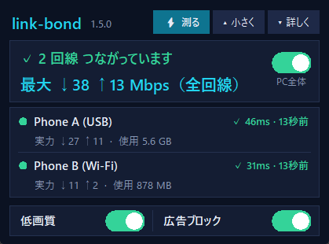
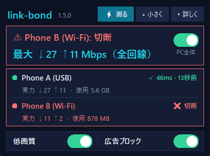

# link-bond

**Use all your internet connections at once - and save mobile data - on Windows. Free.**
Made for people who live on tethering and prepaid SIMs: a phone over USB, another phone, a pocket router ...

**⬇ [Download the latest version](https://github.com/baadee55/link-bond/releases/latest)** · [日本語の説明 → README.ja.md](README.ja.md) · [日本語の解説（図と手順）→ docs/GUIDE.ja.md](docs/GUIDE.ja.md)

One small floating box does everything. Under it is a tiny local proxy (one Python file, no dependencies, no server, no account, free).

* **Low-quality video mode (ON by default)** - videos are slowed to about 2.5 Mbps in total, so players drop to a lower quality by themselves (~480p). Data use falls a lot.
* **Downloads over ALL links** - with the included Chrome extension every download is handed to link-bond, which fetches ONE file from every connection at once, so a single big file really gets the sum of your links. You can also paste a URL in the box.
* **All links at once** - every connected link is used at the same time, each in proportion to its speed. Browsers, parallel downloads and several uploads add up to the sum of the links.
* **Built for unstable links** - a new connection that does not get through on the first link within ~2x its answer time (0.25-1.5 s) is raced on the next one; a link that misses a check is re-checked every 2.5 s and dropped in ~8 s; a cut link is checked every 5 s and used again at once (gently for 60 s, and less if it keeps dropping); names are looked up over every link at once with a last-known fallback; when every link is cut, new connections wait up to 15 s for one to come back. Blips under 20 s are recorded, not notified.
* **Prepaid balance you can see** - type what your carrier says is left; link-bond subtracts what this PC uses and warns at 80 / 95 / 100 %. Top up with one click.
* **Alerts** - a Windows notification when a phone loses the internet (with a hint when it looks like the prepaid credit ran out), when Windows silently joined another Wi-Fi, when a phone keeps dropping, plus a daily "yesterday you used ..." report.
* **Ad / tracker blocking** (optional). For more numbers, open "Dashboard" from the box menu (a page on your own PC, only while link-bond is running).
* If link-bond ever dies the system proxy is removed within seconds: **your internet never stays broken.**
* **A phone hotspot that drops is joined again by itself** (Windows gives up after a few tries).
* **A full connection record** (`connlog` folder, one file per day, 14 days) and a page to read it: **Connection record** in the box (http://127.0.0.1:1081/history) shows per link when it dropped, answer times, time with no link at all, and the page that answered instead of the internet (out of data ...).
* **Auto-repair**: run `install-repair.ps1` once (one administrator prompt). Then a link that does not answer for 90 s, an adapter left without an address, or a Wi-Fi that will not rejoin gets that one adapter restarted (at most every 10 minutes and 12 times a day per adapter), and phone hotspots you used are found even while the phone hides their name. Undo: delete the task `link-bond-repair` and `C:\ProgramData\link-bond-repair`.

## The small box

One desktop icon opens it. It is built not to be in the way:

* **at a glance** - "✓ 2 links connected" and the **maximum speed of all links together**; each link shows that it is alive ("✓ 46 ms · 13 s ago", a tiny check every 15 s), what it can do and the data it used
* **red only where something is wrong** - a cut link, stopped tethering, a VPN that stops the bond ... the folded pill turns red with the problem's name
* **small and movable** - drag it by its title bar; it remembers where you left it; it fades when the mouse is away (right-click: opacity, always on top)
* **⚡ Test** at the top measures every link (~3 MB per link, only when you press it)
* the **PC-wide switch**: ON = the whole PC uses link-bond, OFF = your original settings (the box and the alerts keep running)
* `▾ More` - tabs for the traffic graph, downloads, prepaid balance and events

  

Closing the box (✕) only hides it - click the desktop icon to bring it back. "Quit all" stops everything and restores your settings.

## Read this first (honest limits)

| | |
|---|---|
| **One ordinary connection = one link.** | A browser tab or one streamed video still runs at the speed of one link. Gains appear when many connections run together - and for a single file with *Fast download*. Real packet-level bonding (what Speedify sells) needs a paid server that re-assembles the packets; link-bond deliberately has none, so it is free and nothing leaves your PC except your own traffic. |
| **Fast download needs Range support.** | Most servers have it. Without it the file comes over the best single link. With the Chrome extension, Chrome's downloads use it automatically (not page loads or videos). |
| **Your links must be real alternatives.** | Different phones / SIMs / ISPs. Two connections of the same phone are one link. |
| **Every link works all the time.** | All connected links are used at once, each in proportion to its speed (a link 10x slower gets about 1/10 of the connections). When one drops, the others carry everything; when it comes back it joins again. A phone hotspot that other devices share will be busier, too. |
| **The carrier's real balance cannot be read from a PC.** | You type the starting amount; link-bond counts only what *this PC* sends and receives over that device. Correct it any time. |
| **Eco mode slows video, it does not "force" a quality.** | Traffic is encrypted. A video that is already playing may need a moment or a reload. |
| **Windows 10 / 11 only**, Python 3.9+ with tkinter (the official installer has it). | |

## Quick start

1. Install [Python 3.9+](https://www.python.org/downloads/) ("Add python.exe to PATH").
2. [Download the latest release](https://github.com/baadee55/link-bond/releases/latest) (the zip) and unpack it anywhere.
3. Connect your devices (USB tethering, Wi-Fi hotspot, Ethernet ...).
4. Double-click **`install.bat`**. It puts ONE icon, **link-bond**, on your desktop and starts everything.
5. **On a PC with two or more links, run `keep-connected.ps1` once** (right-click → Run with PowerShell): Windows otherwise may drop Wi-Fi when a wired / USB link comes up, power down USB and Wi-Fi adapters, or roam to another saved Wi-Fi. It asks for administrator permission once and restarts nothing (your links stay up); `-Undo` reverts it.
6. **Recommended: add the Chrome extension** so every download uses all links: `chrome://extensions` → Developer mode → Load unpacked → choose the `browser-extension` folder (the box's *Add to Chrome* button shows the same steps). If link-bond is not running or cannot fetch a file, Chrome downloads it as usual.

To try it without the icon: `python bond.py` and point an application at `127.0.0.1:1080` (SOCKS5 or HTTP).

## Downloads over all links

With the Chrome extension every download started in Chrome goes to link-bond automatically (the browser's cookies, referer and user agent come along, so most logged-in downloads work too). Without it: `▾ More` → Download → paste a URL → **Get**. The file is cut into 1 MB pieces; every link keeps taking the next piece, so a fast link carries more and a slow one fewer, and near the end idle links repeat pieces that a slow link is still working on. The finished file appears in your Downloads folder (never overwrites an existing file); the box shows the share each link carried. Only public `http(s)` URLs are accepted.

## One connection over all links (relay, optional)

Without help from the other side, one connection (one video, one download, one upload) can only use one link:
every link has its own public address. With a **relay** - a small Cloudflare Worker you deploy yourself (free plan
is enough, see [relay/README.md](relay/README.md)) - link-bond cuts big transfers into pieces, sends them over all
links at the same time and the relay puts them back together. One download then gets close to the sum of the links,
and it keeps going when a link drops in the middle. Only download hosts and hosts that moved a lot of data before
are sent this way; login sites and sites hosted on Cloudflare stay direct. Turn it on with `relay.local.txt`.

## How to add a 3rd, 4th ... link

There is no limit in link-bond: every adapter with an IPv4 address and a default route is found by itself, within ~10 s, with no setup. What limits you is hardware:

1. **Another phone by USB cable** with USB tethering ON (Android: Settings → Tethering; iPhone: Personal Hotspot, needs Apple Devices / iTunes on the PC). Use a powered USB hub if you run out of ports. A phone plugged in but not recognised ("Device Descriptor Request Failed" in Device Manager) is almost always the cable or the port - try another cable / a port on the back.
2. **A USB Wi-Fi adapter** (cheap) joined to another phone's hotspot - the built-in Wi-Fi joins only one hotspot at a time.
3. **A USB modem / pocket Wi-Fi with its own SIM** - shows up as a network adapter by itself.
4. **A wired LAN** (home internet) is one more link.

Speeds add up only for different SIMs / contracts. If two phones use the same private address range and clash, make one a Wi-Fi hotspot. Unplugging a phone turns USB tethering OFF on many Androids - switch it on again after replugging.

## What ON changes on your PC - and OFF undoes

* Sets the per-user Windows proxy to `127.0.0.1:1080` (your old proxy settings are saved in `proxy-backup.json`). Local / private addresses bypass the proxy.
* Adds Startup shortcuts so link-bond and the small box come back after a reboot.
* **OFF** gives your original proxy settings back at once. **Quit all** also stops everything and removes the Startup shortcuts.
* link-bond listens on `127.0.0.1` only. The dashboard's write API needs a special header and a local Host, so a web page on another site cannot change your settings.

Applications that ignore the Windows proxy (some games, some VPN clients, command-line tools) are simply not affected.

## When a link drops

* Connections stuck on it are closed at once so apps reconnect through a working link; a link that fails to connect is skipped after 4 s and checked immediately.
* Every change is shown in the box (Events) and as a Windows notification that also lists the state of all devices.
* If Windows joined a different saved Wi-Fi after the phone's hotspot dropped, you are told ("switched network") - speed and data counts then belong to another network.

## VPN

**A desktop VPN and bonding do not mix: to bond two or more links, turn the desktop VPN off.** A desktop VPN (NordVPN, WireGuard ...) puts all traffic into one tunnel over one link. While it is on, link-bond follows it (traffic goes through the VPN), pauses its speed tests / health checks, closes the connections it had on a physical link, and tells you so. Eco mode and ad blocking still apply.

Split tunneling does not solve it: when you exclude link-bond (`linkbond.exe`, a copy of python.exe made for exactly this) from NordVPN, NordVPN still lets excluded apps use only its single "main adapter" - tested: one link works, the others are refused. So split tunneling gives you the VPN plus *one* link through link-bond, not a bond. Browser VPN *extensions* set their own proxy and are not affected either way.

## How it chooses a link

* **What a link can do costs (almost) no data to know.** Its capacity is the best speed it really reached in normal use (Windows' adapter counters, every 2 s), remembered per device and network in `capacity.json`; an old best fades to half in 3 days. Only a link nobody knows yet gets one small test (~0.4 MB); a full test (~3.2 MB per link, `speed.cloudflare.com`) runs only when you press **Measure speed** (or with `--remeasure-hours`).
* **Its condition** comes from a tiny DNS question every 15 s (response time, loss: ~1.2 MB a day per link) and an HTTP check every 2 minutes that also spots a prepaid "out of credit" page (~0.5 MB a day). A missed check starts re-checks every 2.5 s; three misses in a row = cut (~8 s).
* **Red means a problem.** The pill turns red with the problem's name on anything wrong (a cut link, stopped tethering, an unstable link, a VPN stopping the bond ...); the big view paints only the affected line red (a merely slow link is yellow).
* New connections go to the link with the least work per Mbps. While you mostly upload, upload speed counts more.
* Hosts in `pinned.txt` (banks, Google / Facebook logins ...) always use the same link, so a login does not see your IP change.
* Optional **dedicated ports** (`ports.local.txt`): `Android = 1091` opens `127.0.0.1:1091`, which always uses exactly that device.

## Updates

Put a new version of the files in the folder (or `git pull`): within ~15 s link-bond and the small box restart into it by themselves (a file that does not run is ignored), and a notification says what changed (from `CHANGELOG.md`). It also checks GitHub at start and every 6 hours (~5 KB) for a newer release. When one is out (and its tests passed), it is **downloaded (~150 KB) and installed by itself** - only the program files; your settings, balances and `*.local.txt` lists are kept, and the old files go to `update-backup/`. If the new version keeps failing right after start, the previous one is put back automatically. It installs at a quiet moment (waiting up to 6 hours while you use the internet) and never during a link-bond download. The **Update** button in the box installs it at once. A `git` copy is updated with `git pull` when it has no local changes, otherwise it is left alone and gets a button to the release page; the `.exe` build gets that button too. Versions up to 1.5.0 could not check for updates: install 1.5.1 by hand once, then restart Windows (or sign in again).

## Config files (all optional, all private - never published)

| file | content |
|---|---|
| `labels.local.txt` | `Wi-Fi = iPhone (carrier A)` - names shown in the box and in notifications |
| `budget.local.txt` | monthly plans: `iPhone (carrier A) = 20000` (MB) and `reset_day = 15`. For prepaid, use the box. |
| `eco.local.txt` | extra Eco rules: `*.example-video.com = 1.5` (Mbps for all matching connections together) |
| `blocklist.local.txt` | extra blocked domains; `-example.com` lets one through |
| `pinned.local.txt` | extra hosts that must keep one link |
| `ports.local.txt` | one local port per device |

## Files

`bond.py` (the proxy, all logic) · `widget.pyw` (the small box) · `dashboard.html` (detailed screen) · `open.ps1` (the desktop icon) · `run.ps1 stop.ps1 proxy.ps1 start-hidden.ps1` (crash-safe supervisor, proxy switch, start/stop) · `install.bat / uninstall.bat` · `selftest.py` (`python selftest.py` - checks the whole path with no tethering, in a temporary folder) · `eco.txt pinned.txt blocklist.txt` (shipped lists).

## Troubleshooting

* *Speeds do not add up* - one ordinary connection (one video, one browser download) still runs over one link; many connections together, or Fast download for one big file, use all of them. A link's share follows its speed, which is measured and raised automatically when it carries more.
* *A device is missing* - it needs a default route and an IPv4 address. VPN / virtual adapters are skipped on purpose.
* *Plugging in a phone (USB) drops the Wi-Fi hotspot, or the other way round* - Windows can be set to "minimize simultaneous connections" and silently disconnects Wi-Fi when a wired link (USB tethering counts as wired) comes up. Run **`keep-connected.ps1`** once (Windows asks for administrator permission once; `-Undo` reverts it). Restarting Windows' connection manager briefly drops links - afterwards switch USB tethering off and on again on the phone. If the Wi-Fi still drops by itself, check for 2.4 GHz noise from USB 3.0 ports / cables (use a USB 2.0 port or an extension cable, or put the iPhone hotspot on 5 GHz: turn off "Maximize Compatibility").
* *A phone's Wi-Fi hotspot keeps dropping* - a USB cable is usually far more stable. On an iPhone also turn off Low Power Mode / Low Data Mode and keep the Personal Hotspot screen open.
* *Internet seems stuck* - press OFF in the box (or run `stop.ps1`). It always restores the proxy.
* Logs: `bond.log`, `bond.err.log`.

## License

MIT - see [LICENSE](LICENSE).
