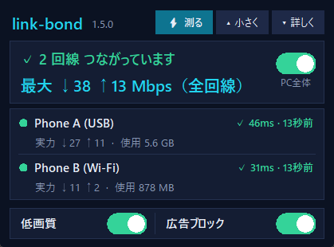
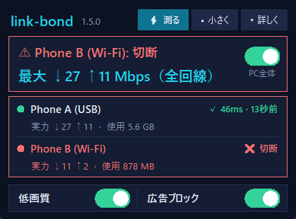

# link-bond 解説（回線まとめ）

スマホのテザリングやプリペイド SIM でネットを使っている人のための、Windows 用の無料ツールです。
**つないだ回線を全部同時に使って速くし、通信量も節約します。**



---

## 1. どんな人向け？

- スマホのテザリングで PC を使っている
- スマホ（SIM）が 2 台以上ある、または USB の Wi-Fi 子機・ポケット Wi-Fi・有線 LAN もある
- 1 本だと遅い、すぐ切れる、通信量が心配

## 2. できること

| | |
|---|---|
| **全回線を同時に使う** | つないだ回線を全部、それぞれの速さに比例して同時に使います。ページを開く、動画を見る、いくつもダウンロードする、といった時に速さが足し算になります。 |
| **一部が切れても止まらない** | 切れた回線の通信はすぐ残りの回線へ移り、ネットは止まりません。戻ればまた加わります。 |
| **大きなファイルも全回線で** | Chrome の拡張機能を入れると、ダウンロードを link-bond が受け取り、1 つのファイルを全部の回線から同時に取ります。 |
| **低画質モード（最初から ON）** | 動画の速さを抑えて、プレイヤーが自動で画質を下げるようにします（480p 前後）。通信量が大きく減ります。 |
| **広告ブロック** | 有名な広告配信への通信を止めます。ページが軽くなり、通信量も減ります。 |
| **プリペイドの残りが見える** | 携帯会社で確認した残りを入れると、この PC が使った分を引いていき、80 / 95 / 100% で知らせます。 |
| **通知** | スマホのネットが切れた・戻った、プリペイドの残高切れらしい、テザリングが止まった、よく切れる、などを Windows の通知で知らせます。 |
| **安全** | link-bond が止まっても数秒で元の設定に戻すので、ネットが止まったままになりません。 |

## 3. しくみ

```
  ブラウザ・アプリ
        │  （Windows のプロキシ設定で、PC の通信が link-bond を通る）
        ▼
  link-bond（この PC の中だけで動く小さなプロキシ）
        │  新しい通信ごとに「一番すいている回線」を選ぶ
        ├──────────▶ 回線 A（USB でつないだスマホ）
        ├──────────▶ 回線 B（Wi-Fi でつないだスマホ）
        └──────────▶ 回線 C …（何本でも）
```

- 通信は **1 本ごと** に回線を選びます。たくさんの通信が同時に動くほど、回線の合計に近い速さになります。
- **1 本の通信（大きな 1 ファイルなど）は、そのままだと 1 回線の速さ** です。ブラウザが暗号化した 1 本の接続で取るので、途中で分けられないからです。そこで、Chrome の拡張機能がダウンロードを link-bond に渡し、link-bond がファイルを 1MB ずつに分けて全回線から同時に取ります。
- パケットを 1 つずつ分ける本格的な束ね（有料サービスのような方式）は、ネット上に専用のサーバーが必要です。link-bond はあえてサーバーを持たないので、**無料で、あなたの通信が他の誰かのサーバーを通りません**。

## 4. 入れ方

1. **Python を入れる**：<https://www.python.org/downloads/> から入れます。最初の画面で「Add python.exe to PATH」にチェック。
2. **link-bond を入れる**：[Releases](https://github.com/baadee55/link-bond/releases/latest) から zip をダウンロードして、好きな場所に展開します。
3. **`install.bat` をダブルクリック**：デスクトップにアイコン **link-bond** ができ、小さな箱が出ます。
4. **2 本以上をつなぐなら `keep-connected.ps1` を 1 回実行**：右クリック →「PowerShell で実行」。管理者の許可が 1 回出ます。
   Windows は、そのままだと「USB がつながると Wi-Fi を切る」「省電力で USB や Wi-Fi を止める」ことがあります。これを止めます（回線は切りません。`-Undo` で元に戻せます）。
5. **（おすすめ）Chrome の拡張機能を入れる**：箱の「詳しく」→「ダウンロード」→「Chrome に入れる」を押すと手順が出ます。
   `chrome://extensions` →「デベロッパー モード」ON →「パッケージ化されていない拡張機能を読み込む」→ `browser-extension` フォルダを選ぶ。

回線（スマホ）は、つなぐだけで約 10 秒後に自動で箱に出ます。設定は要りません。

## 5. 箱の見方

 

| 場所 | 意味 |
|---|---|
| 一番上の「⚡ 測る」 | 全回線の実力を測ります（1 回線 約 3MB の通信量を使うので、押した時だけ）。 |
| 「✓ 2 回線 つながっています」 | 全部うまくいっている時。問題があると赤で「⚠ Phone B: 切断」のように出ます。 |
| 「最大 ↓38 ↑13 Mbps（全回線）」 | 全部の回線を合わせた最大の速さ（各回線の実力の合計）。 |
| 「PC全体」のスイッチ | ON = PC の通信が link-bond を通る。OFF = 元の設定（いつもどおり）。 |
| 回線の行「✓ 46ms・13秒前」 | その回線が生きている証拠。15 秒ごとに小さく確認して、応答の速さを出します。 |
| 「実力 ↓27 ↑11・使用 5.6 GB」 | その回線の実力（実際に出た最高の速さ）と、この PC が使った量（残りを入れていれば残り）。 |
| 低画質・広告ブロック | スイッチで ON/OFF。 |
| 「▴ 小さく」 | 1 行のピルに。問題があるとピル全体が赤になります。 |
| 「▾ 詳しく」 | グラフ・ダウンロード・残り容量・出来事のタブ。 |


- 箱はタイトルバーをつかんで動かせます。マウスが離れると薄くなります（右クリックで透明度・常に手前を変更）。
- 閉じても（✕）隠れるだけ。デスクトップのアイコンでまた出ます。「完全に終了」で全部止めて元に戻ります。

## 6. 通信量について（表示のために使う量）

| 何のため | 量 |
|---|---|
| 回線が生きているかの確認（15 秒ごとの小さな問い合わせ） | 1 回線 1 日 約 1.2MB |
| プリペイドの残高切れ画面の確認（2 分ごと） | 1 回線 1 日 約 0.5MB |
| 初めての回線の小さな速度測定 | 1 回だけ 約 0.4MB |
| 「⚡ 測る」 | 押した時だけ 1 回線 約 3MB |
| 新しい版のお知らせの確認 | 1 日 約 5KB |

回線の実力は、ふだんの通信で実際に出た最高の速さから学ぶので、測るための通信はほとんど要りません。

## 7. VPN を使っている人へ

- **PC 版の VPN（NordVPN など）がついていると、束ねられません。** VPN は全部の通信を 1 本のトンネルにまとめるからです。その間 link-bond は VPN に従い、「VPN 中のため束ねていません」と知らせます。
- VPN のスプリットトンネリングで link-bond を外しても、NordVPN では回線が 1 本しか使えませんでした（実測）。2 本以上を束ねる時は、PC 版の VPN を切ってください。
- ブラウザの VPN 拡張機能は、独自のプロキシを使うので影響を受けません。

## 8. 3 本目、4 本目…

link-bond の側に上限はありません。

- スマホをもう 1 台 USB でつなぐ（ポートが足りなければ給電つき USB ハブ）
- USB の Wi-Fi 子機で、別のスマホのホットスポットにつなぐ（内蔵 Wi-Fi は同時に 1 つまで）
- SIM を入れる USB モデム / ポケット Wi-Fi
- 有線 LAN

速さが足し算になるのは、**別の SIM・別の契約** の時だけです。

## 9. よくある質問

**Q. 速さが足し算にならない**
1 本の通信（動画 1 本・ブラウザのダウンロード 1 つ）は 1 回線で動きます。通信がたくさん同時に動く時、または拡張機能を入れたダウンロードで全回線が使われます。

**Q. スマホの Wi-Fi ホットスポットがよく切れる**
ホットスポットより USB ケーブルの方がずっと安定します。iPhone なら低電力モードを切り、「インターネット共有」の画面を開いたままに。同じホットスポットにつないだ他の機器も一緒に切れるなら、原因はスマホ側（電波・回線）です。

**Q. USB をつなぐと Wi-Fi が切れる**
`keep-connected.ps1` を 1 回実行してください（4 の手順 4）。

**Q. 「テザリング停止中」と出る**
USB は挿さっているのに、スマホから IP アドレスが来ていません。多くの Android は USB を抜くとテザリングが OFF に戻ります。スマホで USB テザリングを OFF → ON。

**Q. 私の通信はどこかに送られる？**
いいえ。link-bond はこの PC の中だけで動きます（`127.0.0.1` だけで待ち受け）。外に出るのは、あなたの通信そのものと、上の表の小さな確認（Google の公開 DNS `8.8.8.8`、Cloudflare の `cp.cloudflare.com` / `speed.cloudflare.com`、更新確認の GitHub）だけです。

**Q. やめたい**
箱の「完全に終了」で全部止まり、元の設定に戻ります。消す時は `uninstall.bat`。

**Q. 新しい版は？**
新しい版が出ると箱と通知で知らせます。ファイルを入れ替えると、約 15 秒で自動的に新しい版で動き出し、変更点を知らせます。

---

ライセンス：MIT（無料・改変も自由）。不具合や要望は [Issues](https://github.com/baadee55/link-bond/issues) へ。
